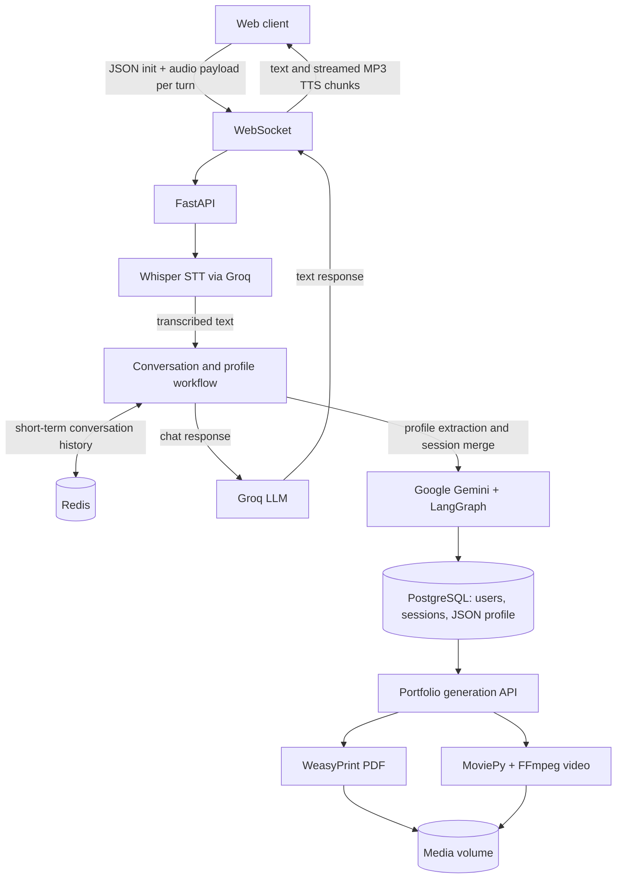

# Memórias Vivas

[](https://www.python.org/)
[](https://fastapi.tiangolo.com/)
[](https://www.docker.com/)
[](https://www.postgresql.org/)
[](https://redis.io/)
[](LICENSE)

**Final project for the BSc in Computer Engineering — grade: 19/20.**

[Watch Demo Video](https://example.com/replace-with-demo) · [Academic Poster (PDF)](https://example.com/replace-with-poster.pdf) · [API Docs (/docs)](http://localhost:8000/docs)

## Overview

The system must process voice conversations with low perceived latency while converting unstructured autobiographical speech into persistent, queryable profile data; Memórias Vivas uses a FastAPI WebSocket voice pipeline, Redis-backed session history, PostgreSQL JSON data, and LLM-assisted profile extraction and merging to generate biographical artefacts.

## Architecture and data flow



The repository currently implements Whisper through Groq, uses Groq for conversational responses, and uses Gemini with LangGraph for profile extraction/merging. TTS is provided by `edge-tts`. The audio WebSocket accepts a complete recording as a binary message for each turn; it streams response text and audio back to the client.

## Engineering decisions

- **WebSocket instead of HTTP polling:** A persistent, bidirectional connection carries control messages and each audio turn without repeated request setup or polling. The server streams response text and TTS audio on the same connection. The current client uploads a recording per turn; it does not stream microphone audio in small uplink chunks.
- **Redis for volatile session state:** Recent conversation history is keyed by `session_id` in Redis, keeping repeated context reads and writes out of PostgreSQL. At session close, the API consolidates the conversation into the long-term profile and removes the Redis history.
- **PostgreSQL with JSON profile data:** Relational tables and UUID relationships maintain user, session and artefact integrity. The profile's `perfil_json` stores extracted autobiographical attributes whose shape can evolve without requiring a relational column for every entity.

## Quickstart

### Requirements

- Docker Engine and Docker Compose v2.
- Groq API key for chat and Whisper transcription.
- Google API key for Gemini profile extraction and merging.

The Compose configuration reads database variables from the repository-root `.env` and loads API settings from `backend/.env`. The same template can be copied to both locations:

```bash
git clone https://github.com/BrunoNeto2022131358/memorias-vivas.git
cd memorias-vivas
cp .env.example .env
cp .env.example backend/.env
# Edit both files and set GROQ_API_KEY and GOOGLE_API_KEY.
docker compose up --build
```

`DATABASE_URL` in the API environment must use the Compose service hostname `db`, not `localhost`. The supplied example contains the local-development URL and credentials. Change the database password and `SECRET_KEY` before using any non-local deployment. Do not commit populated `.env` files.

- API base URL: <http://localhost:8000>
- OpenAPI/Swagger UI: <http://localhost:8000/docs>
- Health check: <http://localhost:8000/health>

## Main endpoints and WebSocket protocol

All paths below are relative to `/api/v1`, except `/health`.

| Method | Path | Purpose |
| --- | --- | --- |
| `POST` | `/auth/registar` | Create an account and return tokens |
| `POST` | `/auth/login` | Authenticate and return tokens |
| `POST` | `/chat/` | Chat request; creates a `session_id` when omitted |
| `POST` | `/chat/conversa/personalizada` | Chat using the user's persisted profile |
| `POST` | `/chat/sessao/encerrar` | Extract/merge session facts into the profile and record the session |
| `POST` | `/artefactos/livro-memorias` | Generate a PDF biography |
| `POST` | `/artefactos/video` | Generate an MP4 biography |
| `GET` | `/artefactos/{artefacto_id}/download` | Download a generated artefact |

### Create a chat session

There is no standalone REST session-creation route. A chat request without `session_id` creates a Redis-backed session and returns its ID:

```bash
curl -X POST http://localhost:8000/api/v1/chat/ \
  -H 'Content-Type: application/json' \
  -d '{"mensagem":"Quero partilhar uma memória da minha infância."}'
```

Use the returned `session_id` on subsequent chat requests. The personalized chat route requires a user profile, normally created through the onboarding flow.

### Voice WebSocket

The implemented endpoint is `ws://localhost:8000/api/v1/audio/ws/conversa` (not `/ws/audio-stream/{session_id}`). Send a JSON initialization message, then one binary audio recording per turn:

```json
{"type":"init","user_id":"<user-uuid>","session_id":null,"tema":"memorias","voz":"pt-PT-RaquelNeural"}
```

The server responds with a `pronto` message and then uses JSON messages such as `transcricao`, `resposta_inicio`, `resposta_chunk`, `resposta_fim`, `audio_inicio`, and `audio_fim`. MP3 audio chunks are sent as binary WebSocket messages. The client may send further binary recordings over the same connection. See the protocol implementation in [`backend/app/api/ws.py`](backend/app/api/ws.py).

### Generate and download portfolio artefacts

Replace `<user-uuid>` with an existing user ID. These routes currently accept `user_id` in the JSON body; the artefact routes do not declare an authentication dependency.

```bash
curl -X POST http://localhost:8000/api/v1/artefactos/livro-memorias \
  -H 'Content-Type: application/json' \
  -d '{"user_id":"<user-uuid>"}'

curl -X POST http://localhost:8000/api/v1/artefactos/video \
  -H 'Content-Type: application/json' \
  -d '{"user_id":"<user-uuid>"}'
```

Each returns an artefact record with an `id` and `url_download`. Download the generated file with:

```bash
curl -L -o portfolio.pdf \
  http://localhost:8000/api/v1/artefactos/<artefact-id>/download
```

PDF and video generation are implemented in the artefact service and write to the Compose `media_data` volume. The current video route performs generation as part of the HTTP request; it is not an external worker queue.

## Tests and validation

The repository includes an integration/performance report script at `backend/test_suite_relatorio.py`. It expects the API, PostgreSQL and Redis to be running, configured provider keys, and test data. It makes real provider calls and creates artefacts; run it only against a disposable development environment:

```bash
docker exec memorias_vivas_api python test_suite_relatorio.py
# Optional categories: implementacao, funcional, desempenho
docker exec memorias_vivas_api python test_suite_relatorio.py --categoria implementacao
```

For pytest-based tests, install pytest in the API container and run discovery from the backend directory:

```bash
docker exec memorias_vivas_api python -m pip install pytest
docker exec -w /app memorias_vivas_api python -m pytest -q
```

The project dependencies do not currently declare pytest; add it to the development dependencies when adopting pytest as the maintained test runner.
